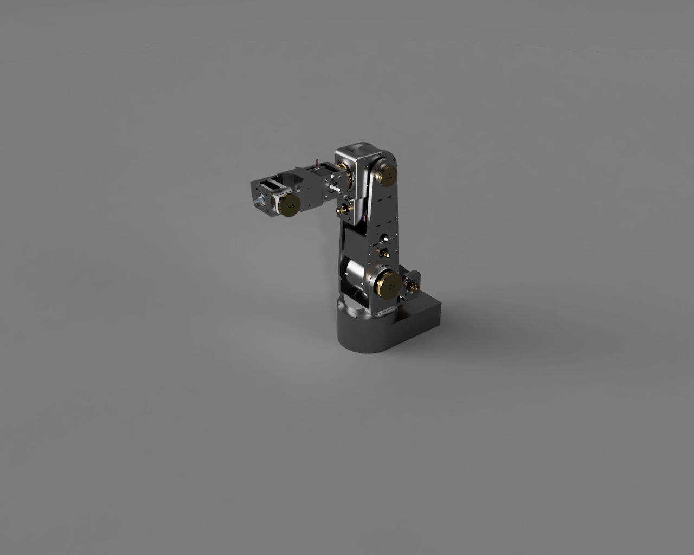
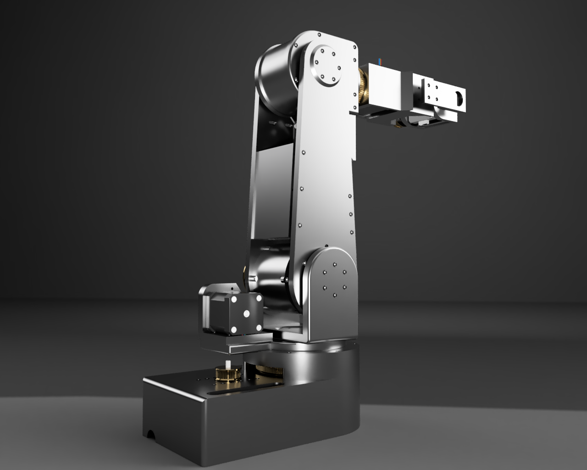
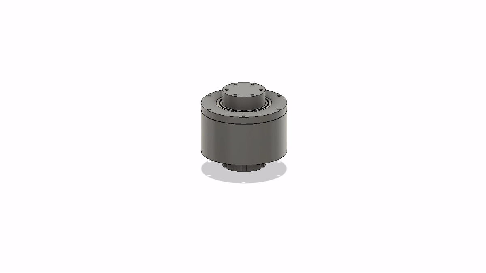
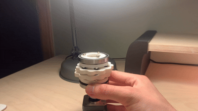
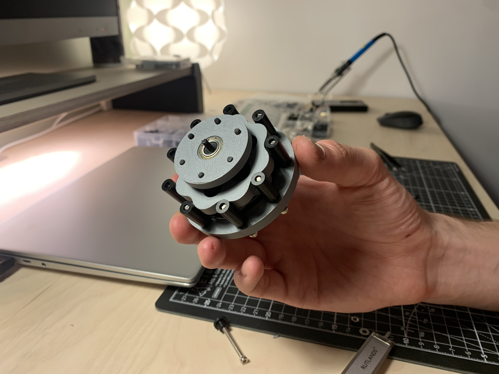

# Robot Arm
This is an undergoing project that I started over summer 2026. I wanted to gain experience with mechanical design, embedded systems, electronics and ROS2, along with gaining a platform that I can use in the future to develop other skills such as computer vision and human robot interaction.

The aim was to built a cheap, 6DoF robot arm that prioritises precision over payload.

  
  <em>Figure 1: Renders of robotic arm</em>

## Conceptual Design
I decided on a 6DoF arm to give myself the most flexibility for later projects. I decided on a composite pulley and cycloidal drive based reduction system achieving up to 27:1 reduction ratios.

Loads were estimated for each joint, and link size was chosen appropriately. I wanted to keep the budget low (currently under £150) and stuck with Nema 17 stepper motors to power each joint.

## Mechanical Design
I started by designing cycloidal drives for the shoulder and elbow joints. This deserves a write up in itself, but I wanted to do this to teach myself some CAD before attempting the real arm. When testing each iteration of the drive, there was a lot of off-axis flexing and the shaft actually snapped a couple of times. This required a redesign of the shaft, with 3 screws running through it for rigidity and to prevent any single screw from backing out.

The arm was designed using a top-down approach, with parameters and skeletal links defined first. This was my first time modelling something as complex as this, and I learned a lot in a short space of time such as the power of parametric modelling, joints and overall component-based design. Many, many 3D prototypes were created for each part, with the specific size of the belt tensioners being tricky to size in particular.

  
  <em>Figure 2: Exploded cycloidal drive</em>

  
  <em>Figure 3: Early cycloidal drive iteration</em>

## Code
ROS2 was chosen as the middleware for this system due to prior experience and its widespread use in industry. However, all previous work with ROS2 was in simulation. I had never interfaced with hardware before this project, which was a steep learning curve. The order of development was as follows:

### Stepper testing
Hardware control knowledge was improved by completing a [balance beam project](https://github.com/msmith693/Balance-Beam-via-Object-Detection).

### Stepper State Machine
A state machine was written in Arduino to move steppers through a series of poses. This was my first time implementing this design pattern in C++.

### Serial based control via ROS2-control hardware interface
This was the hardest step, as I was unfamiliar with the ros2-control library. Serial control was established between the Arduino and laptop. There was separation of responsibilities here, with the Arduino only parsing the motor commands and sending signal to the motors. It then updates the current state interfaces which are sent back over serial to the laptop running ROS2.

A custom hardware interface was written to send command interfaces and read state interfaces over serial.

### Moveit2 control
The arm is now fully controllable via MoveIt2 and uses its motion planning library to compute inverse kinematics. The arm can be controlled via RViz and continually publishes joint states on the ROS2 network.

  
  <em>Figure 4: Robot arm interfacing with MoveIt2</em>

## 4th year Honours Project - Gaze Control
For my penultimate year in university I wanted to build upon this platform and incorporate computer vision, as this is an area I find fascinating. 

I decided to work on gaze control, whereby a user can control the robot arm by where they look and how they gesture. This is an active field of research with promising applications in assitive autonomy. For many people suffering from degenerative diseases, reduced motor control often affects the eyes last. It is also a natural way of communicating intent.

This is a work in progress and updates will come.
